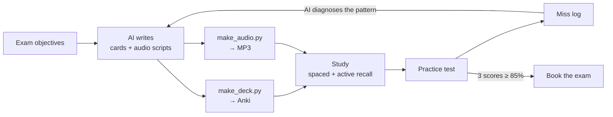

# Network+ AI Study Kit

**Handy dandy lil repo to use your own AI (agnostic) to turn CompTIA Network+ (N10-009) into car audio, Anki flashcards, and a study plan that adapts to your practice-test misses.**


I built this system while preparing for Network+. I had a job, a long commute, and little desk time. So I used AI to turn the exam objectives into audio I could drill while driving and flashcards I could review in spare minutes between life. Then I fed my practice-test misses back to the AI and rebuilt the material around my weak spots.

I'm publishing the finished materials and the system that made them, when I have time between doing other things. The system works around your real life. A certificate is just flair to a career and learning track.

I added Anthropic's Claude as a contributor. I used them to create the AI flashcards and Audio. Fair disclosure. A feature not a bug.

> 🎥 **Video walkthrough:** *coming soon* · 💼 **Author:** Daniel McKinlay · MSCS, U.S. Army veteran

---

## What's inside

| Folder | What it is |
|---|---|
| [`decks/`](decks/) | Ready-to-import Anki decks — **~2,000 cards** across a full-coverage deck, a rapid-recall deck, a trouble-areas deck, and five quick decks |
| [`audio/`](audio/) | Car-ready MP3 drills with answer pauses. Files ship as [GitHub Release](../../releases) assets |
| [`prompts/`](prompts/) | Copy-paste prompts for ChatGPT, Claude, Gemini, or any capable model |
| [`docs/`](docs/) | The method: set a target, set a timeline, how learning works, and the adaptive loop |
| [`tools/`](tools/) | Two Python tools: **CSV → Anki deck** and **script → verified MP3** (local, free, no API key) |
| [`templates/`](templates/) | Miss log, score tracker, study plan, card CSV |
| [`examples/`](examples/) | A sample card CSV and a sample two-voice audio script to test the tools |

## The system in one picture



The loop is the point. Generic material gets you to about 70%. Material rebuilt from **your** misses closes the gap.

---

## Quick start

### Path 1 — Just study (5 minutes)
1. Install [Anki](https://apps.ankiweb.net/) (free on Windows, Mac, Linux, Android; AnkiMobile is paid on iOS).
2. Download a deck from [`decks/`](decks/) and double-click it.
3. Download the MP3s from the [latest release](../../releases/latest). Put them on your phone. Drive.
4. Read [`docs/06-adaptive-loop.md`](docs/06-adaptive-loop.md) before your first practice test.

### Path 2 — Build your own material (30 minutes)
1. Follow [`docs/01-define-the-target.md`](docs/01-define-the-target.md) and [`docs/03-study-plans.md`](docs/03-study-plans.md). Set your date.
2. Open [`prompts/`](prompts/) and run the planning prompt with your AI.
3. Generate cards as CSV → build a deck:
   ```bash
   pip install -r tools/requirements.txt
   python tools/make_deck.py my-cards.csv --name "Network+ N10-009::My Deck" --out my-deck.apkg
   ```
4. Generate an audio script → render it:
   ```bash
   python tools/make_audio.py my-script.txt --kokoro models/kokoro-en-v0_19 --out audio/
   ```
   Full walkthroughs: [flashcards](docs/05-flashcard-pipeline.md) · [audio](docs/04-audio-pipeline.md).

### Path 3 — No code at all
Every prompt in [`prompts/`](prompts/) works in a normal chat window. Ask the AI for a CSV, paste it into a file, and use Anki's built-in **File → Import**. For audio, paste the script into any text-to-speech app.

---

## My Study Log

I passed Network+ (N10-009) on September 24, 2026. This log covers the 22 days before the exam.

Before September 3 I was watching videos and taking in information passively. I don't count that time. The count starts when I began studying on purpose.

### The numbers

| | |
|---|---|
| Window | Sep 3 – Sep 24, 2026 (22 days) |
| Study days | 19 |
| Days off | 3 |
| Total study time | 105 h 15 m |
| Average per study day | 5 h 32 m |

### Time by method

| Method | Time (h:mm) | Share | Days used |
|---|---:|---:|---:|
| Flashcards | 36:15 | 34.4% | 17 |
| Udemy* | 31:00 | 29.5% | 16 |
| AI audio | 16:15 | 15.4% | 6 |
| Practice tests | 8:00 | 7.6% | 6 |
| YouTube* | 7:15 | 6.9% | 4 |
| Podcast | 2:00 | 1.9% | 1 |
| Dion study guide | 2:00 | 1.9% | 1 |
| AI prompting | 1:30 | 1.4% | 3 |
| Reviewing past tests | 1:00 | 1.0% | 1 |
| **Total** | **105:15** | **100%** | **19** |

\* Video time is adjusted for playback speed. I logged video by content length and watched at a mix of 1x and 2x. I count it at 1.5x: content hours ÷ 1.5, rounded down to the nearest 15 minutes. 57 h 45 m of video took 38 h 15 m to watch.

Flashcards took the most time. Flashcards, practice tests and test review together were 45 h 15 m, or 43% of the total.

### How it went

- **Sep 3. Started studying on purpose.** I stopped passively taking in videos. Flashcards every day. Practice tests from Sep 5.
- **Sep 6. Started this repo.** I could see progress with the AI help. I decided to put the setup in a git repo. This was also my first day using AI audio.
- **Sep 7. 76% on practice tests.** I figured I would pass at that point.
- **Sep 9. Job offer.** I got a job offer and mentally dropped everything. Two hours of flashcards that day. Nothing on Sep 10.
- **Sep 11. Back to work.** I studied 12 of the next 14 days. Mostly Udemy and flashcards.
- **Sep 24. Passed.**

---

## The method

1. **[Define the target](docs/01-define-the-target.md)** — the exam, the five domains, their weights, the passing score.
2. **[How learning works](docs/02-how-learning-works.md)** — retrieval, spacing, interleaving, and why hitting a topic from several angles beats re-reading.
3. **[Pick a plan](docs/03-study-plans.md)** — 7-day sprint, 30-day standard, or 60-day part-time.
4. **[Audio pipeline](docs/04-audio-pipeline.md)** — scripts written *for the ear*, rendered locally.
5. **[Flashcard pipeline](docs/05-flashcard-pipeline.md)** — card rules that hold up on exam day.
6. **[The adaptive loop](docs/06-adaptive-loop.md)** — practice test → miss log → diagnosis → rebuilt material.
7. **[Exam week](docs/07-exam-week.md)** — readiness gates, the last 72 hours, and test-day tactics.
8. **[Reuse it for your next cert](docs/08-next-cert.md)** — Linux+, Security+, CCNA, AWS.

## Exam at a glance (N10-009)

| Domain | Weight |
|---|---|
| 1.0 Networking Concepts | 23% |
| 2.0 Network Implementation | 20% |
| 3.0 Network Operations | 19% |
| 4.0 Network Security | 14% |
| 5.0 Network Troubleshooting | 24% |

Up to 90 questions · 90 minutes · passing score 720 on a 100–900 scale · multiple choice plus performance-based questions. Always confirm current details on the [official CompTIA page](https://www.comptia.org/certifications/network).

---

## Design choices

- **Your AI, not mine.** The prompts are model-agnostic. No API keys, no subscription lock-in.
- **Local, free, verified audio.** [Kokoro](https://huggingface.co/hexgrad/Kokoro-82M) neural TTS runs on a laptop CPU. A local speech recognizer checks each sentence and re-renders any it can't understand. Voices were chosen by measured clarity, not by ear ([details](docs/04-audio-pipeline.md#choosing-voices-measure-dont-guess)).
- **Idempotent decks.** Card IDs derive from the card text. Re-import an improved deck and Anki updates cards in place. Your review history survives.
- **Binaries out of git history.** MP3s ship as release assets, not commits, so the repo stays small to clone.
- **CI.** A GitHub Action builds the sample deck on every push, so the tooling is always known to work.

## Accuracy and fair use

AI makes mistakes. I checked this material against the official N10-009 objectives, but check anything that looks wrong and [open an issue](../../issues). Nothing here reproduces questions from any paid practice-test vendor. Build your own misses into your own decks; don't publish a vendor's questions.

CompTIA and Network+ are trademarks of CompTIA, Inc. This project is independent and not affiliated with or endorsed by CompTIA.

## Roadmap

- [x] Project scope and licenses
- [x] The method: define the target, how learning works, study plans
- [x] Tracking templates: miss log, score tracker, study plan
- [x] `make_deck.py` — CSV → Anki deck, with CI
- [x] ~2,000 Anki cards: core, rapid recall, trouble areas, quick decks
- [x] `make_audio.py` — local two-voice TTS for car drills
- [x] Audio drills (GitHub Release)
- [x] Prompt library for any AI model
- [x] The adaptive loop: practice test → miss log → rebuilt material
- [x] Exam-week guide and reuse for the next cert
- [ ] v1.0 + video walkthrough
- [x] Add metrics to README

Watch or star the repo to follow along.

## License

Code in `tools/` and `.github/`: [MIT](LICENSE). Study content (docs, prompts, decks, audio): [CC BY-NC-SA 4.0](LICENSE-CONTENT.md). Share it, adapt it, credit it, don't sell it.

## Contributing

Found a wrong fact? Have a better prompt? See [CONTRIBUTING.md](CONTRIBUTING.md).
