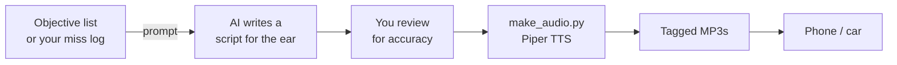

# 4. Audio Pipeline — Study While You Drive

**Goal:** turn exam objectives into MP3 drills you can play in the car. Answer out loud during the pauses.



## Step 1 — Write scripts for the ear, not the eye

This is the step most people get wrong. If you feed a TTS engine your notes, you get "pipe four four three pipe H T T P S pipe T C P." Useless.

A good audio script:

- **Speaks numbers the way techs say them.** "Fourteen thirty-three," not "one thousand four hundred thirty-three." "Four forty-three," not "four hundred forty-three."
- **Turns tables into drills.** Question, pause, answer, one-line reason.
- **Spells acronyms or phonetically respells them.** "S N M P." "Tack-acks plus." TTS engines guess badly at acronyms.
- **Uses short sentences.** Long sentences are hard to follow while merging onto a freeway.
- **Repeats the key fact twice.** Once in the answer, once in the reason.
- **Leaves real pauses.** 3–5 seconds. Long enough to say the answer.
- **Keeps tracks to 7–15 minutes.** One track, one topic. Easy to replay.

The [audio script prompts](../prompts/02-audio-scripts.md) bake all of this in.

## Step 2 — Check the script

Read it once before you render it. AI mixes up port numbers, standards, and distances more often than you'd expect. Spot-check anything with a number against the official objectives or your course. Two minutes of checking saves you from drilling a wrong answer thirty times.

## Step 3 — Render it locally

### Install (one time)

```bash
# Python 3.10+ and ffmpeg required
pip install -r tools/requirements.txt

# Windows:  winget install ffmpeg
# macOS:    brew install ffmpeg
# Linux:    sudo apt install ffmpeg
```

Download the voice model and, optionally, the speech recognizer used for the clarity check. Both come from the [sherpa-onnx releases](https://github.com/k2-fsa/sherpa-onnx/releases) and unpack into a `models/` folder:

```bash
mkdir models && cd models
# Voices: Kokoro, 11 English voices in one model (~330 MB)
curl -L https://github.com/k2-fsa/sherpa-onnx/releases/download/tts-models/kokoro-en-v0_19.tar.bz2 | tar xj
# Optional clarity check: NVIDIA Parakeet speech recognizer (~630 MB)
curl -L https://github.com/k2-fsa/sherpa-onnx/releases/download/asr-models/sherpa-onnx-nemo-parakeet-tdt-0.6b-v2-int8.tar.bz2 | tar xj
cd ..
```

On Windows, download the two `.tar.bz2` files in a browser and extract them with 7-Zip.

### Choosing voices: measure, don't guess

The first version of this course used two Piper voices. Some lines came out slurred. So I tested 12 voices the same way: render 40 real lines from the scripts, have a speech recognizer transcribe each one, and count the lines where 20% or more of the words were misheard.

| Voice | Words misheard | Garbled lines (of 40) |
|---|---|---|
| Piper LibriTTS speaker 59 (old answer voice) | 9.6% | 5 |
| Piper Ryan high (old question voice) | 8.2% | 4 |
| Piper HFC male | 4.8% | 3 |
| Kokoro **bm_george** (new answer voice) | 4.2% | 1 |
| Kokoro **am_michael** (new question voice) | 3.7% | 1 |

Some of that remaining ~4% is the recognizer's own error and scoring noise, not the voice. The gap between the old pair and the new pair is still clear: about half the errors and a quarter of the garbled lines. Two different accents also make it obvious who is asking and who is answering.

Other Kokoro voices: `af_sarah`, `af_bella`, `af_nicole`, `af_sky` (US female), `am_adam` (US male), `bf_emma`, `bf_isabella` (UK female), `bm_lewis` (UK male).

### Script format

```text
# TITLE: Track 04 - Port Drill

[A] What port does S S H use?

[PAUSE 4]

[B] Twenty-two. T C P. It replaced Telnet on twenty-three.
```

- `[A]` and `[B]` pick the voice. Untagged paragraphs use voice A.
- `[PAUSE n]` inserts *n* seconds of silence.
- `//` lines are comments.
- Blank lines separate blocks.

See [`examples/sample-audio-script.txt`](../examples/sample-audio-script.txt).

### Render

Default voices, one script:

```bash
python tools/make_audio.py scripts/04_port_drill.txt --kokoro models/kokoro-en-v0_19
```

A whole folder, with a pronunciation lexicon and the clarity check:

```bash
python tools/make_audio.py scripts/*.txt \
  --kokoro models/kokoro-en-v0_19 \
  --voice-a am_michael --voice-b bm_george \
  --lexicon examples/lexicon.json \
  --verify models/sherpa-onnx-nemo-parakeet-tdt-0.6b-v2-int8 \
  --album "Network+ N10-009 - My Weak Spots" \
  --out audio/
```

What the tool does for you:

- **Checks what it speaks** (with `--verify`). A local speech recognizer transcribes every sentence of four or more words and compares it to the script. If 20% or more of the words come back wrong, the sentence is re-rendered at a slightly different speed, and the clearest take is kept. Anything still unclear is listed at the end so you can reword it.
- **Spells acronyms.** Any all-caps word like `EIGRP` is read as "E I G R P". The lexicon handles the ones people say as words: VLAN is "V-lan", RADIUS is "radius", SLAAC is "slack".
- **Caches every segment.** Stop it halfway and rerun. It picks up where it stopped. Edit one line and only that line re-renders.
- **Evens out volume** (EBU R128 loudness normalization), so no track is quieter than the rest in the car.
- **Tags MP3s** with title, album, and track number (from the filename prefix, e.g. `04_`). Car stereos and podcast apps play them in order.
- **Encodes at 64 kbps mono.** Clear for speech, about 0.5 MB a minute.

`--speed 0.95` (the default) gives roughly 155 words per minute. Use 1.0 for faster, 0.9 for slower.

**Piper voices still work** with `--piper voices/en_US-lessac-high.onnx` (install `piper-tts` first). They're smaller and faster. In my tests they were less clear.

## Step 4 — Get it into the car

- **Phone + Bluetooth:** copy MP3s to your phone and play them in any music or podcast app that supports local files.
- **USB stick:** most car stereos play MP3s from a USB drive in track order.
- **Private podcast feed:** apps like Pocket Casts (Files) or VLC work well for "resume where I left off."

## How to listen

1. **Answer out loud.** Mumbling counts. Silent "yeah, I know that" does not.
2. **Replay tracks on a schedule.** Day 1, day 2, day 4, day 7. Spacing works for audio too.
3. **Rebuild after every practice test.** Your best audio is the track generated from your own misses. See [the adaptive loop](06-adaptive-loop.md).

## No-code option

Skip the Python. Paste the script into any TTS tool: your phone's accessibility "speak screen," Microsoft Edge "Read aloud," or a paid voice service. You lose the pauses and the two voices, but the retrieval-style script still does most of the work.

---

**Next:** [5. Flashcard pipeline →](05-flashcard-pipeline.md)
