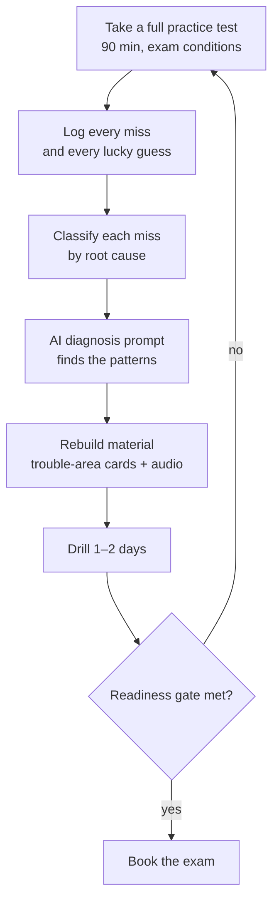

# 6. The Adaptive Loop — Let Your Misses Write Your Study Plan

A practice test is not a grade. It's a diagnostic. Most people look at the score, feel something, and take another test. That wastes the most valuable data you have.

This loop turns every miss into targeted material within an hour.

## Step 1 — Take the test properly

- 90 minutes. No notes. No pausing. No looking things up.
- Flag every question you guessed on, even if you got it right. **A lucky guess is a miss you haven't paid for yet.**
- Use a different exam each time. Retaking the same one measures memory of that exam, not of networking.

## Step 2 — Log every miss

Use [`templates/miss-log.csv`](../templates/miss-log.csv). One row per miss or guess.

| Column | Example |
|---|---|
| `date` | 2026-09-14 |
| `source` | Practice exam 3 |
| `q_num` | 41 |
| `domain` | 5 |
| `objective` | 5.5 |
| `topic` | DHCP relay |
| `my_answer` | Change the DHCP scope |
| `correct_answer` | Configure ip helper-address on the router |
| `miss_type` | K (see below) |
| `why_i_missed_it` | Didn't know DHCP broadcasts don't cross routers |
| `concept_in_my_words` | DHCP Discover is a broadcast. Routers drop broadcasts. A relay forwards it as unicast. |

**Write the concept in your own words, not the vendor's question.** That's better for learning, and it keeps you on the right side of copyright if you ever share your cards.

## Step 3 — Classify each miss by root cause

The fix depends on *why* you missed it. Tag every miss with one code.

| Code | Miss type | What it looks like | The fix |
|---|---|---|---|
| **K** | Knowledge gap | "I'd never heard of that." | Learn it. New cards + a short audio segment. |
| **D** | Discrimination | "I mixed up RPO and RTO." | A *vs* card for the pair. A confusion-killer audio segment. |
| **A** | Application | "I knew the fact but not how it applies." | Scenario cards. "Symptom → cause → tool." |
| **R** | Reading | "I missed the word NOT / BEST / FIRST." | No new cards. Slow down. Underline qualifiers on the next test. |
| **P** | Procedure / PBQ | "I couldn't do the subnet / config / order the steps." | Hands-on reps at a desk. Not audio. |
| **G** | Lucky guess | Right answer, wrong confidence | Treat as K or D. |

After a few tests, the distribution tells you what's wrong with your *studying*, not just your knowledge:

- **Mostly K** → coverage gap. Go back to the course for those objectives.
- **Mostly D** → you know the words but not the boundaries. Build discrimination cards.
- **Mostly A** → too much definition-style studying. Switch to scenario cards and troubleshooting drills.
- **Mostly R** → a test-taking problem. Practice reading the last sentence first.
- **Mostly P** → schedule pencil-and-paper or lab time. Cards won't fix it.

## Step 4 — Let AI find the patterns

Paste your miss log into the [practice-test analysis prompt](../prompts/04-practice-test-analysis.md). It will:

1. Group misses by domain, objective, and miss type.
2. Spot the *underlying* concept behind clusters of different-looking misses.
3. Rank your top weak areas by exam weight × miss rate.
4. Produce a 1–3 day remediation plan.
5. Hand off to the card and audio prompts with the right inputs.

## Step 5 — Rebuild your material

Two outputs per loop:

1. **A trouble-areas deck.** Generate with the [miss-driven card prompt](../prompts/03-flashcards.md#prompt-3c--miss-driven-trouble-area-cards). Aim for about 3–5 cards per miss: the fact, the discriminator, and a scenario. Tag them `missed-once`. If the concept shows up again on a later test, retag as `missed-twice`.
2. **A weak-spot audio track.** Generate with the [miss-driven audio prompt](../prompts/02-audio-scripts.md#prompt-2c--miss-driven-drill). Listen on the next two commutes.

## Step 6 — Shift your time by the numbers

Use [`templates/score-tracker.csv`](../templates/score-tracker.csv) to track each domain across tests. Then allocate study time:

| Domain score | Action |
|---|---|
| **< 70%** | Priority. 40–50% of study time until it clears 75%. Revisit the course. |
| **70–79%** | Active. Trouble-area cards and audio daily. |
| **80–89%** | Maintain. Normal Anki reviews. |
| **≥ 90%** | Coast. Reviews only. Don't spend new time here. |

Weight it by the exam blueprint. A 65% in Domain 5 (24% of the exam) costs more points than a 65% in Domain 4 (14%).

## Step 7 — Check the readiness gate

> **Ready** = three **different** practice exams ≥ 85% in the last 7 days, no domain below 75%, and no miss type above 30% of your misses except R.

Met it? Book the exam within a week, while it's fresh. Not yet? Run another loop. Each loop takes about 2–3 hours including the test.

## Worked example (illustrative)

Say practice exam 3 produced 14 misses and 3 guesses:

- 9 of 17 in Domains 2 and 5.
- 6 were type **D**: RPO/RTO, SFTP/FTPS, Layer 2/Layer 3 switches, IDS/IPS, NAT/PAT, 802.11ac/ax.
- 4 were type **A**, all "which tool for this symptom."

The AI diagnosis names the real gap: **boundary confusion between similar terms**, plus **symptom-to-tool mapping**. The response:

- About 28 discriminator cards (each pair, both ways).
- About 12 symptom → tool scenario cards.
- One 10-minute "confusion killers" audio track.

On exam 4, watch the D count, not just the score. If D-type misses fall, the fix worked. If they don't, the cards are too definition-style. Rewrite them as scenarios.

---

**Next:** [7. Exam week →](07-exam-week.md)
